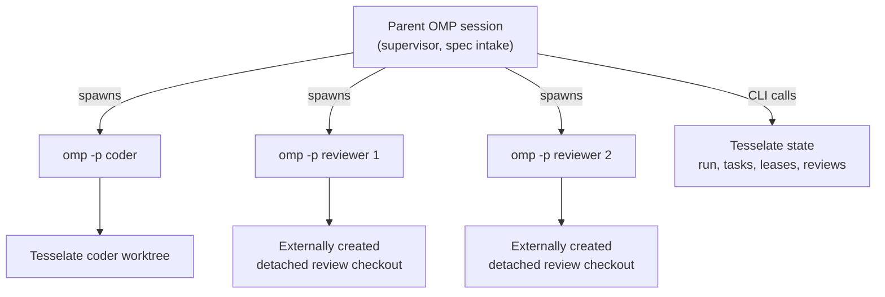

# Tesselate

Tesselate is a local coordination service for coding agents. It gives a supervisor, coding agents, and independent reviewers a shared workflow across local Git repositories. Agent harnesses run the agents; Tesselate coordinates their assignments, worktrees, messages, reviews, and decisions.

The MVP is local and Unix-only. It uses a single SQLite database and does not host models, connect to remote repositories, or merge changes into a project's primary branch.

## What it does

- Coordinates runs, dependent tasks, assignments, leases, and bounded retries.
- Reopens a budget-exhausted task after an explicit supervisor repair choice.
- Creates isolated Git worktrees and records submitted commit references.
- Enforces independent review rounds, findings, and finding dispositions.
- Supports optional human approval gates resolved through the CLI.
- Serves concurrent agent sessions through MCP over a local Unix socket.
- Persists workflow history in SQLite and exports portable JSON Lines and Markdown artifacts.

## How it fits together

Tesselate is the coordination layer; an agent harness runs the agents. In the
[OMP integration](#omp-integration), the extension inside the parent OMP session
acts as the supervisor: it gathers the feature specification and launches
separate `omp -p` processes. The standard workflow uses one coder and two
reviewers with separate worktrees and role-specific credentials.



A **Tesselate run** is the logical wrapper: `run_id` groups the supervisor,
coder, reviewers, worktrees, reviews, and artifacts. Tesselate’s internal
“sessions” are credential sessions, not agent processes. It does not host the
model or the agent loop.

In the OMP flow, the extension calls the `tesselate` CLI directly against
SQLite. The separate `tesselate serve` coordinator and MCP socket are for MCP
clients; they are not required for the `/feature` workflow.

## Requirements

- Rust toolchain and Cargo
- Git
- Unix-like operating system (the coordinator and MCP adapter use Unix-domain sockets)

## Build and test

```sh
cargo build
cargo test
```

The end-to-end acceptance scenario creates temporary local Git repositories and launches the real coordinator and MCP adapter processes:

```sh
cargo test --test f11_e2e -- --nocapture
```

## Quick start

Bootstrap the first supervisor credential. Tesselate writes it to a private credential file and returns the credential once in the JSON response. Keep that response private.

```sh
cargo run --bin tesselate -- credential bootstrap --actor-name supervisor
```

Create a project configuration file. Repository paths and `artifact_dir` may be relative to the configuration file's directory.

```toml
name = "example"
artifact_dir = ".tesselate-artifacts"

[[repositories]]
id = "app"
path = "/path/to/app"

[workflow]
max_duration_hours = 24
max_concurrent_assignments = 4
max_task_retries = 2
max_review_rounds = 3

[review]
min_independent_reviewers = 2

# Optional. Omit [human] for autonomous operation.
[human]
completion_approval = false
high_severity_deferral_approval = false
```

Register the project with the `credential_file` path returned by bootstrap:

```sh
cargo run --bin tesselate -- \
  --credential-file /path/from/bootstrap/supervisor.token \
  project register --config ./project.toml --idempotency-key register-example
```

Start the shared coordinator in one terminal:

```sh
cargo run --bin tesselate -- serve
```

The default state directory is `.tesselate`; set `--state-dir` or `TESSELATE_STATE_DIR` to use another location. CLI commands and the coordinator use the same SQLite database in that directory.

Issue credentials for agent sessions using the supervisor credential. Each issued credential is stored under the state directory and shown only on first issuance:

```sh
cargo run --bin tesselate -- \
  --credential-file /path/from/bootstrap/supervisor.token \
  credential issue --actor-name coder-1 --role coder --idempotency-key issue-coder-1
```

Configure an MCP harness to launch `tesselate-mcp` with the issued credential and the coordinator socket. For example, the process needs these environment variables:

```text
TESSELATE_SOCKET=/path/to/.tesselate/coordinator.sock
TESSELATE_CREDENTIAL=<credential for this agent>
```

The adapter speaks MCP on stdio and forwards requests to the shared coordinator. Never put credentials in tool arguments or logs. Use `tesselate call` for any versioned coordination tool, or the purpose-built `inspect`, `human`, `workspace`, and `artifact` commands. Mutating calls require an idempotency key.

## OMP integration

For OMP sessions working in repositories under `~/Development`, install the
bundled OMP extension and feature skill once:

```sh
tesselate install omp
```

This uses `~/Development/.tesselate` for private coordinator state,
credentials, run handoffs, worktrees, and artifacts. The installer places an
extension, skill, and credential-file-path configuration in the active user's
OMP agent directory; it adds no credentials or OMP files to a project repository.
When running a binary from this checkout instead of an installed `tesselate` on `PATH`, use
`./target/debug/tesselate install omp`. `install omp`, `uninstall omp`,
`project ensure`, and `project provision` default to this shared state directory;
other CLI commands retain the existing `.tesselate` default. Pass `--state-dir`
explicitly when calling those commands by hand against the shared installation.

Installation follows the active `OMP_PROFILE` / `PI_PROFILE`, if set; otherwise
it targets the default `~/.omp/agent` profile. Install separately for each named
profile. The generated OMP configuration stores credential **file paths**, not
bearer values. The installed CLI recovers an expired, non-revoked supervisor
session only from its owner-only local credential file; socket/MCP authentication
continues to reject expired credentials.

Start OMP from a repository, or from `~/Development`, and ask for a new feature
in a named repository. The integration asks for the feature goal and acceptance
criteria, then uses Tesselate for the run, assigned coding worktrees, independent
reviews, and durable history. `/feature` is the explicit alternative when a
plain-language request is ambiguous. To register a repository directly:

```sh
tesselate project ensure --repo ~/Development/bitwars
```

### Plan before coding

At setup, choose **UX design** for changes to user or player flows, decisions,
or feedback; **UX checklist** for small changes within an existing interaction;
or **No UX stage** for changes with no user-facing effect.

After approval, two independent planners inspect separate detached checkouts
of the same base and propose implementation steps, verification, and risks.
In UX design mode, a third, independent designer runs alongside them and
proposes the interaction, edge states, and observable checks. Planning and
design workers use read-only OMP tools and receive no provisioned files.

The supervisor selects one architecture proposal and, for UX work, reconciles
it with the design or writes a short checklist. It can ask one planner or
designer for one targeted revision. If a conflict remains, no coder starts:
clarify the requirements and choose **Start new run**.

The supervisor saves the selected plan, rationale, and any agreed UX brief in
`omp-runs/<run-id>/record.json` before coding. Coders and reviewers see the same
brief, not the alternatives. `/feature resume` reuses valid planning results and
the saved brief. Existing runs retain their original planning scope.

For an interrupted run, use `/feature resume` in OMP. It selects an existing
run for the chosen repository without asking for a new goal, acceptance criteria,
or validation command; `/feature resume <run-UUID>` targets one run directly.
The existing provisioning approval and validation-log retry safeguards still
apply. Restart OMP after `install omp` to load an updated extension.

When a task exhausts its coding retry or review round budget, OMP pauses and
offers a repair choice: try one more round, reset the attempt count to zero and
try again, or leave it for manual repair. The first two call
`tesselate.v1.tasks.repair`, which raises the run's pinned limits just enough,
reopens the task, and records a `task.repaired` event. Manual repair leaves the
run stopped or the comparison candidate failed; use `/feature resume` after
resolving the cause outside Tesselate.

When a resumed run completes, the extension writes
`omp-runs/<run-id>/completion.json` and injects a short completion message into
the OMP session so the agent and user see the result instead of only a transient
notification. Use `/feature status` for the latest run in the current repository,
or `/feature status <full-run-UUID>` for a specific run. Status works for active,
paused, stopped, and completed runs.

### Compare two implementations

In OMP, use `/feature --workflow compare <goal>`, or explicitly ask for two
independent implementations in a feature request. OMP proposes a preset; the
start confirmation shows the agent counts and validation command. `standard`
remains the default unless the repository opts in.

Both coders start at the same base commit in separate worktrees and implement
the selected plan independently. Each candidate gets its own reviews and
revisions. The same approved command validates each reviewed candidate in a
dedicated detached checkout, then validates the winner again on the integration
branch. Candidate validation checkouts do not receive provisioned files. Use a
command that can run without those files for `compare`.

If both pass, a fresh read-only reviewer compares the two commits and recommends
`A`, `B`, or `neither`. You choose which candidate to integrate, if any. If
only one qualifies, Tesselate asks before integrating it and does not run a
head-to-head review. Neither passing means nothing is integrated. The winning
commit alone advances the integration branch; both lanes' histories stay in
the same run. `/feature resume` uses the saved preset and review progress, not
the current repo config.

To set a repository default or define named presets, add `.tesselate.toml` at
the repo root. A file is not required to use either built-in preset.

```toml
default_workflow = "standard"

[workflows.standard]
candidates = 1
reviewers_per_candidate = 2

[workflows.compare]
candidates = 2
reviewers_per_candidate = 2
comparison_reviewers = 1
winner_approval = "human"
```

The per-candidate reviewer count cannot be below the project's minimum.
Comparison requires two assignment slots, exactly one comparison reviewer,
and human approval.

### Provisioning and validation

To opt into copying ignored local files for a repository, configure an
integration-only policy once. Bitwars' existing `.workmux.yaml` lists these paths:

```sh
tesselate project provision --repo ~/Development/bitwars \
  --copy .env --copy .env.local \
  --copy apps/web/.env --copy apps/web/.env.local \
  --copy apps/web/.env.development --copy apps/web/.env.development.local \
  --copy services/rts-engine/.env \
  --copy packages/content/.revisions
```

The private policy lives beside the generated project configuration under
`~/Development/.tesselate/projects/`; repeat the same command safely, or use
`--replace` to change its copy list. Other repositories can list their own
Git-ignored relative paths. Tesselate shows present and missing optional paths
for approval before creating a run, then snapshots files into the integration
worktree with owner-only permissions. It neither copies to coder/reviewer
worktrees nor executes workmux `post_create`, `pre_merge`, or `pre_remove` hooks,
which can run arbitrary commands. Symlinks, tracked paths, and changed
destinations stop provisioning for inspection; file contents are never logged.

Set a repository-wide validation default in `.tesselate.toml` at the repo root.
For example, to use a Bitwars engine build:

```toml
[validation]
command = "cargo build -p rts-engine"
```

OMP includes that command in the normal start confirmation without a separate
command prompt. To override it for one run, include the exact command in your
feature request (for example, “For this run, validate with `cargo test -p
rts-engine --lib`”). With no default, OMP proposes an existing build command
for the affected target when clear, and asks for a command only when it has
no proposal. `/feature resume` uses the approved command saved with the run.
A successful build verifies compilation, not feature behavior; choose a
targeted test when the acceptance criteria need it.

The extension launches separate OMP processes for coders and reviewers using
the initiating session's selected model. Select the model before starting or
resuming; an in-flight worker is not switched.
Ordinary OMP subagents share their parent's MCP connection and cannot represent
independent Tesselate roles. A task worktree is not the integration branch.
Validation never runs in a coder or reviewer checkout. Do not run shared
services in task worktrees. Bitwars' configured ignored files are copied into
the integration checkout only after approval; absent optional files are skipped.
No automatic push, PR creation, or merge into local `main`.

## Live status

Watch active OMP-coordinated runs, grouped by `run_id`, with one line per agent:

```sh
tesselate status --watch
```

Completed, stopped, and paused runs are hidden while any run is active. When no
run is active, the most recent run is shown with a “No active runs” notice. Use
`tesselate status --all` or `tesselate status --watch --all` to include every run.

Each line shows the role, its assignment, and current status. Active agents show
an animated cursor. The OMP bridge writes supervisor and worker heartbeats every
two seconds; a heartbeat older than 15 seconds is stale. Runs created before
heartbeat support fall back to worker PID and OMP session activity. `tesselate
status` without `--watch` prints one snapshot. This view is read-only and does
not require a credential.

Reviewer workers may print progress before their final JSON response. Tesselate
parses only a final JSON object or fenced JSON response and rejects trailing
non-JSON output. If a worker ended without a valid final response, `/feature
resume` archives the old log as `<label>.log.attempt-<timestamp>` and starts a
fresh attempt for that role. Provider failures such as usage limits are included
in the pause message.

Workspace inspection reports both `capture_ready` and `clean`. Committed work
can be captured when branch/HEAD identity matches and there are no tracked
changes or non-ignored untracked files; ignored build output and local handoffs
do not block review. Cleanup remains stricter: `clean` is false while any
ignored files remain, so deleting a worktree cannot discard local data.

```sh
tesselate uninstall omp
```

Uninstall removes only Tesselate-owned, unmodified OMP integration files; it
preserves coordinator state, credentials, project configurations, and worktrees.
Restart OMP to load an installed or removed extension.

## Documentation

- [Product and technical specification](docs/spec.md)
- [M001 milestone plan and feature workflow](docs/milestones/m001-mvp/README.md)
- [End-to-end scenario and observed results](docs/milestones/m001-mvp/f11-e2e-results.md)
- [Architecture decision records](docs/adrs/)
